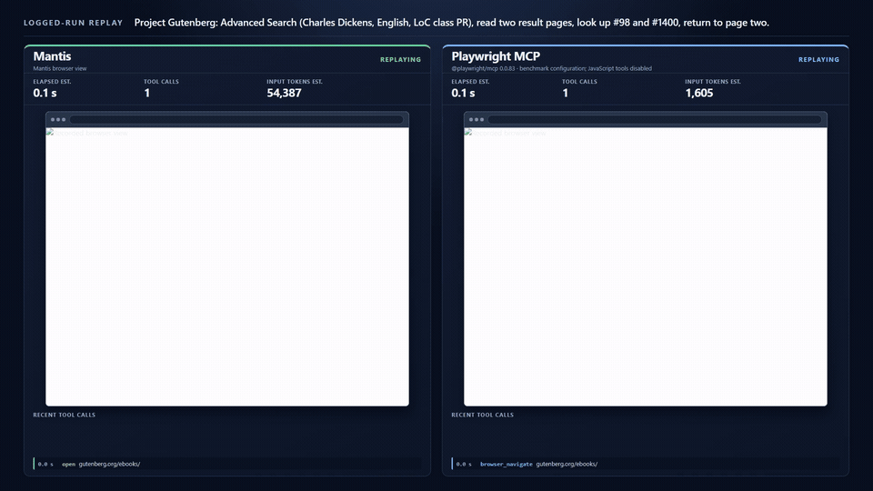

<p align="center"></p>

**Lets AI agents browse the web as short, numbered text instead of screenshots.**

[perzian.dev/mantis](https://perzian.dev/mantis/) · by [Perzian](https://perzian.dev)

It works with Claude Code, Codex, Cursor or your own agent as an MCP server. [Install in two commands](docs/SETUP.md#install).

```bash
npx -y -p mantis-browser mantis install
claude mcp add mantis -- npx -y -p mantis-browser mantis-mcp
npx -y -p mantis-browser mantis read https://example.com   # try it without an agent
```

Windows, Linux servers and other agents: [SETUP](docs/SETUP.md#install).

<p align="center"></p>

*One real task (Luna, logged runs replayed): about a third less time, over 2x fewer input tokens, about half the calls. This is a selected example from 16 long tasks; medians across all 16 are in [Results](#results). [Full video](video/mantis-demo.mp4).*

Security and threat model: [SECURITY.md](SECURITY.md).

## How it works

<p align="center"></p>

## What the agent sees

<p align="center"></p>

## Results

Mantis vs the accessibility tree (Playwright MCP) on public sites, `gpt-6-luna` and `claude-haiku-5-5`. Every cell is a per-run median; time is end-to-end wall time per run:

**Long tasks** (correct: 14 tasks, 42 runs per cell, deterministic answer keys; medians: all 16 tasks, 48 runs per cell):

| | Luna Mantis | Luna tree | Haiku Mantis | Haiku tree |
|---|---:|---:|---:|---:|
| Correct | **35/42** | 34/42 | **42/42** | 41/42 |
| Input tokens (median) | **262k** | 362k | **432k** | 746k |
| Tool calls (median) | **18** | 25 | **26** | 32 |
| Time (median) | **50s** | 75s | **90s** | 135s |

**Short tasks** (30 tasks, 90 runs per cell):

| | Luna Mantis | Luna tree | Luna screenshot | Haiku Mantis | Haiku tree | Haiku screenshot |
|---|---:|---:|---:|---:|---:|---:|
| Correct | 88/90 | 86/90 | **90/90** | **90/90** | 88/90 | 88/90 |
| Input tokens (median) | **63k** | 99k | 104k | 43k | 88k | **33k** |
| Tool calls (median) | **2** | 4 | 7 | **3** | 5 | 6 |
| Time (median) | **27s** | 31s | 35s | 24s | 31s | **23s** |

Long tasks: about a third less time and 28-42% fewer input tokens, accuracy within one run of the tree (Luna +1, Haiku +1 of 42). Short tasks (clean re-run, one build, all approaches interleaved): accuracy equal or better than the tree, 37-51% fewer input tokens and 13-22% less time than the tree. Against screenshots: Luna screenshots score 2 runs higher and use 67% more tokens and 29% more time; Haiku screenshots use about 22% fewer tokens and are about even on time, with 2x the tool calls.

Short-task and long-task scores are graded by deterministic answer keys on the captured final state. Two of the 16 long tasks (iframe and tab chains) cannot be keyed from saved evidence and are left out of the correct counts, so those counts do not match the earlier model-judged table (Luna 41/48 vs 37/48, Haiku 47/48 vs 44/48 over 16 tasks, kept in RESULTS only for reproduction). The 1-run gaps are within noise. One short task was swapped after scoring. Screenshot baseline, local workflows, method and all caveats: [bench/RESULTS.md](bench/RESULTS.md).

## Limitations

- Canvas and WebGL apps, including drawing tools, maps and charts, are described only as canvas. `data`, `ocr` and `look` are available, but there is no coordinate click, drag or draw tool.
- Login and bot walls need `ask_human`, which needs a display.
- Benchmarks cover read, navigate and form-fill tasks on public and demo sites with Luna and Haiku; production authenticated and write-heavy workflows are not measured.
- Long real-site correctness is graded by deterministic final-state keys on 14 of 16 tasks; process rules (on-site search, visit order) are not checked, and the two iframe/tab chain tasks are excluded. `long-local-v1` measures local fixtures with a deterministic full-ledger grader.
- The screenshot baseline is this project's own tool, not a third-party product.
- Some live-v1 tasks were swapped after results; this is disclosed in [bench/RESULTS.md](bench/RESULTS.md).
- Page content is untrusted data; see [SECURITY.md](SECURITY.md).
- This is a small v0.1.x beta project.

## Learn more

- [How it works in detail](docs/APPROACH.md)
- [Claude skill](skill/README.md): teaches Claude how to read Mantis output
- [Install, configuration and tool reference](docs/SETUP.md)
- [Re-running the benchmarks](bench/README.md)

## License

MIT
