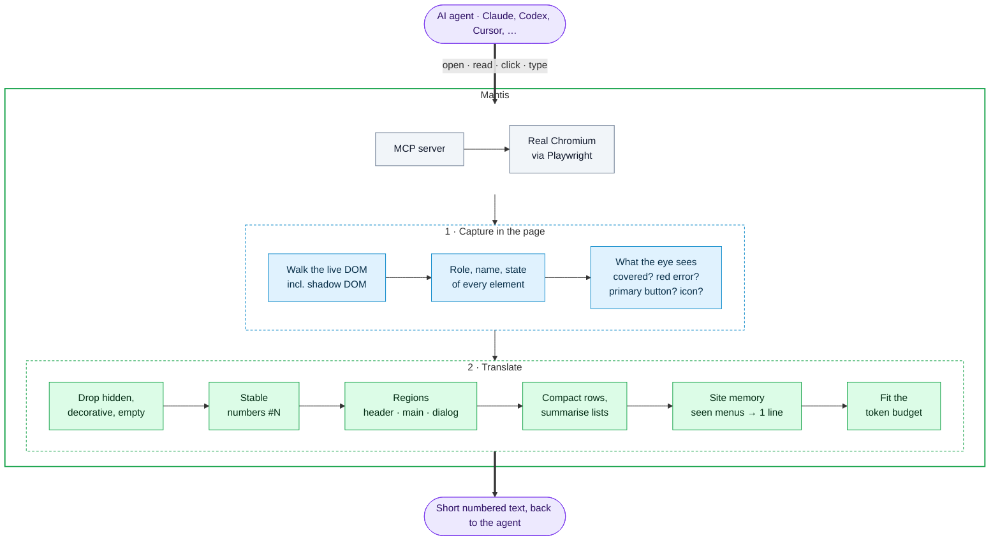
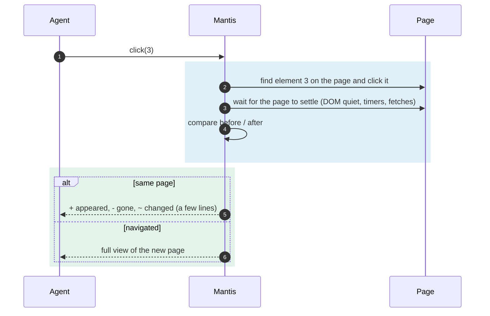

# Approach

How Mantis turns a web page into numbered text an agent can read and act on.

## 1. How agents browse today

Screenshots cost ~1,400 tokens per look (1280×800) and use coordinate clicks.
The accessibility tree gives roles, names and states (`button "Sign in"`, `checked`, `disabled`)
so agents act by reference. Mantis adds visual cues and compacts repeated content;
[the comparison](#3-mantis-vs-the-accessibility-tree) lists the differences.

## 2. The Mantis approach

**Rule: Mantis = the accessibility tree + what a person would notice by looking − the noise.**
The design goal is to preserve useful visible information from the tree and add visual context,
while keeping trimmed content reachable through search and fallbacks.



What the agent receives:

```
Page: Shop
[dialog "Accept cookies?" — covers page]
  #3 button "Accept"
  #4 button "Reject"
[main]
  # Shop
  #1 button "Add to cart" (covered)
  #2 button ~"trash"
```

### Acting: changes only



### When text isn't enough: the fallback ladder

Follow the [skill's fallback ladder](../skill/SKILL.md#tools): `media`/`data` → `ocr` →
`look` (one element, ≤800px) → `ask_human` (5-minute default). Only `look` returns an image.
The human handoff carries browser storage state into a headed window. Mantis never solves CAPTCHAs.

## 3. Mantis vs the accessibility tree

| | Accessibility tree | Mantis |
|---|---|---|
| Popup covering the page | not shown | `[dialog — covers page]`, items marked `(covered)` |
| Unlabelled icon button | `button` | `button ~"trash"` (`~` = inferred, never presented as fact) |
| Red error under a field | only if `aria-invalid` is set | `error: "Invalid email"` |
| Main call-to-action | looks like any button | `(primary)` |
| After a click | dump the whole tree again | only what changed |
| Element references | tied to a snapshot | stable `#N` while the element lives |
| Menus on page 2, 3, 4… | repeated in full | one line (site memory) |
| Charts / canvas | nothing | `data(id)` returns the numbers |
| Clickable only by script (`div` + click listener) | not shown | `clickable "Pro plan"` |
| Iframes (payment, login widgets) | per frame | inline under `[iframe "Payment"]`, own numbers |
| Size | whole page | budgeted, compacted |

Measured results and their limits: [bench/RESULTS.md](../bench/RESULTS.md).

## 4. Decisions along the way

- **Capture and actions.** An in-page walker records role, name, state, box, visibility and coverage.
  Playwright resolves numbered elements and supplies actionability checks and auto-wait.
- **Controls and action feedback.** `select` and `fill` list the options of multi-select controls;
  readable `name` or `id` values name otherwise-unlabelled inputs, textareas and selects. Repeated
  date-attribute and selectable-grid cells get action ids. File inputs show selected basenames, and
  `upload` reports selection rather than submission. A click blocked by a combobox suggestion popup
  reports: “press Escape, select a suggestion, or click elsewhere”. `page` re-reads the view when only
  the URL changed.
- **Stable ids.** A `WeakMap<Element, number>` on `window` keeps each element's number while it lives;
  numbers are never reused within a page load.
- **Text format and budget.** `#N role "name" (states)`; regions in `[brackets]`, headings without ids.
  Target a typical `read()` at ≤~1,500 tokens and an action result at ≤~300; compact long lists without hiding access.
- **No information loss.** Short standalone text (list items, status messages, footers) is kept;
  collapsed lists name their items; `find("text")` reaches trimmed content. The [coverage test](../test/coverage.test.ts) checks
  selected synthetic and local benchmark pages against Chrome's accessibility tree, with explicit exclusions.
  It is a regression check, not proof of coverage on every page.
- **Speed.** The page scan returns one JSON string instead of Playwright's structured serializer
  (3x faster on big pages). When an in-page counter says nothing changed (DOM, scroll, input, focus,
  hover), the last scan is reused as the diff's "before". After an action Mantis waits 150 ms of DOM
  quiet; short timers and requests are tracked separately, so delayed effects are still caught.
  Chrome `computedName` was rejected because scanning was roughly 25x slower.
- **Beyond the tree.** Elements made clickable only by script (a click listener, or where a pointer
  cursor starts) show as `clickable`, containers excluded. Visible iframes, cross-origin included,
  are read inline under `[iframe "title"]` with their own number range (`#10001…`).

The goal for each change: preserve useful information, use fewer tokens, add meaning, and avoid slowing actions.
Local-v1, local-v2 (48 cases), local-v2.1 (54 cases), and the separate live-site set [live-v1 v1.7](../bench/RESULTS.md#live-site-scorecard-live-v1-v17) are complete and frozen. See the [evaluation plan](PLAN.md#evaluation-plan).
